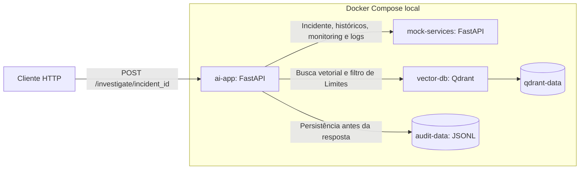
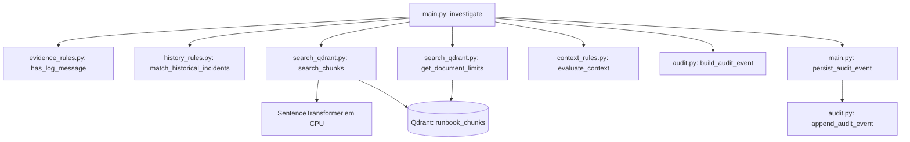
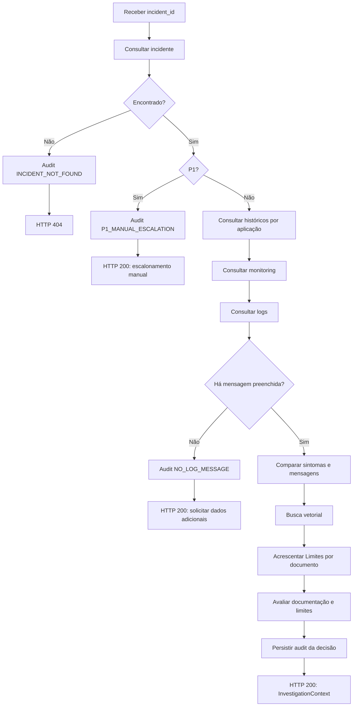

# Arquitetura do AI Incident Operations Assistant

Este documento descreve a implementação atual. Consulte o [README](../README.md)
para preparação, execução e comandos de testes. As referências de código são
[AI App](../ai-app/main.py), [Mock Services](../mock-services/main.py) e
[Compose](../compose.yaml).

## Escopo e serviços

A aplicação reúne evidências fictícias e experiências históricas, recupera
runbooks e aplica regras determinísticas. Não há LLM, geração de recomendações,
execução de ações corretivas ou notificação externa de escalonamento.

| Serviço | Acesso pelo host | Endereço na rede Compose | Persistência |
|---|---|---|---|
| `ai-app` | `127.0.0.1:8000` | Porta `8000` | `audit-data` em `/app/audit` |
| `mock-services` | `127.0.0.1:8001` | `http://mock-services:8000` | Dados fictícios em memória |
| `vector-db` | `127.0.0.1:6333` | `http://vector-db:6333` | `qdrant-data` em `/qdrant/storage` |

A AI App recebe `MOCK_SERVICES_URL`, `QDRANT_URL` e `AUDIT_PATH`. Os padrões no
código são `http://localhost:8001`, `http://localhost:6333` e
`/app/audit/events.jsonl`. O Compose substitui as duas URLs por endereços da rede.

Os módulos de execução são copiados pelo Dockerfile. Testes, avaliadores,
experimentos e dados precisam da montagem do projeto para execução no container.
O Compose não prepara a coleção documental nem configura healthchecks.

## Estrutura e responsabilidades

| Arquivo ou diretório | Responsabilidade |
|---|---|
| [main.py](../ai-app/main.py) | Rotas, contratos Pydantic, orquestração, retornos antecipados e persistência obrigatória antes das respostas de negócio |
| [evidence_rules.py](../ai-app/evidence_rules.py) | Função pura `has_log_message`: existe mensagem não vazia após `strip()` |
| [history_rules.py](../ai-app/history_rules.py) | Função pura de correspondência exata entre sintomas e mensagens, após `strip().casefold()` |
| [search_qdrant.py](../ai-app/search_qdrant.py) | Embedding da consulta, busca vetorial e recuperação paginada de Limites |
| [context_rules.py](../ai-app/context_rules.py) | Função pura `evaluate_context`: documentação e limites determinam prontidão ou abstenção |
| [audit.py](../ai-app/audit.py) | Construção de eventos e append JSONL |
| [mock-services/main.py](../mock-services/main.py) | Incidentes, históricos, monitoring e logs fictícios |
| [evals/retrieval_cases.json](../evals/retrieval_cases.json) | Seis expectativas de recuperação, independentes dos resultados observados |
| [eval_common.py](../ai-app/eval_common.py) | Regra de aprovação por IDs e resumo com código de saída |
| [eval_retrieval.py](../ai-app/eval_retrieval.py) | Carregamento dos casos e avaliação da busca vetorial |
| [eval_document_context.py](../ai-app/eval_document_context.py) | Avaliação da busca acrescida dos Limites por documento |
| [experiments/](../experiments/) | Contagem de tokens, comparação A/C e relatório; não substituem o índice oficial |

`search_qdrant.py` instancia modelo e cliente Qdrant na importação. Importar
`main.py` normalmente carrega o modelo e pode baixar pesos, mesmo que a requisição
seguinte seja P1 ou termine por falta de logs. O retorno antecipado evita chamadas
de recuperação, mas não esse carregamento inicial.

## Contratos e fluxo HTTP

A AI App expõe `GET /health` e `POST /investigate/{incident_id}`. O Mock expõe
`GET /health`, `/incidents/{incident_id}`, `/historical-incidents?application=...`,
`/monitoring/{application}` e `/logs/{application}`.

O incidente possui `incident_id`, `application`, `priority` e `summary`. Cada log
possui `timestamp`, `level` e `message`; os campos são strings, sem validação da
janela temporal do incidente.

Históricos têm `historical_incident_id`, `application`, `summary`, `symptoms`,
`resolution` e `observed_result`. O Mock filtra aplicação por igualdade exata,
ordena por ID e retorna lista vazia com HTTP 200 quando não encontra registros.
`application` é obrigatório e não pode ser string vazia; espaços não são removidos.

A coleta usa um único `httpx.AsyncClient(timeout=5.0)`. O timeout configura limites
nas operações HTTP, não um tempo máximo para toda a investigação. A comparação de
históricos ocorre depois da coleta; as operações documentais e de gravação usam
`run_in_threadpool`.

### Três respostas de negócio

Todas incluem `audit_event_id`, extraído do evento já persistido. O endpoint usa
uma união de modelos Pydantic:

| Modelo | Campos e significado |
|---|---|
| `EscalationResponse` | Incidente, `status="manual_escalation_required"` e motivo; P1 só consulta o incidente |
| `MissingLogMessageResponse` | Incidente, `status="additional_data_required"`, `analysis_code="NO_LOG_MESSAGE"`, motivo e `requested_data` |
| `InvestigationContext` | Incidente, monitoring, logs, históricos, correspondências, documentação, limites e decisão |

`NO_LOG_MESSAGE` ocorre se a lista de logs for vazia ou todas as mensagens
ficarem vazias após `strip()`. Solicita mensagem observada, período/fuso e operação
afetada com comportamento esperado e observado. Não interpreta resumo, nível ou
conteúdo; não afirma que métricas ou toda evidência estejam ausentes. Históricos
já recuperados são registrados no audit, mas não são comparados nesse caminho.

`InvestigationContext.historical_incidents` mantém todos os registros recuperados.
`historical_incident_matches` contém modelos `HistoricalIncidentMatch`, com
`historical_incident` completo e `matched_symptoms`. A comparação usa igualdade de
texto completo após normalização de caixa e espaços nas bordas, sem pontuação
semântica. Preserva ordem e grafia original e evita repetir sintomas equivalentes
por logs duplicados. Essa correspondência não determina causa raiz ou resolução.

### Recuperação e decisão documental

A consulta vetorial combina aplicação, resumo e mensagens atuais dos logs. O
modelo é `sentence-transformers/paraphrase-multilingual-MiniLM-L12-v2`, em CPU;
`search_chunks` usa por padrão `top_k=3` e `min_similarity=0.50`, na coleção
`runbook_chunks`. A seção `Limites` é buscada por filtro para cada documento
recuperado, com paginação, sem atribuição de score.

`documentation_status` é `retrieved` ou `no_matches`. A decisão depende somente de
documentação e limites, não dos históricos ou correspondências:

| Condição | `analysis_code` | `analysis_status` |
|---|---|---|
| Nenhum trecho recuperado | `NO_DOCUMENTATION` | `abstained` |
| Algum documento recuperado sem limites | `MISSING_DOCUMENT_LIMITS` | `abstained` |
| Todos os documentos recuperados têm limites | `CONTEXT_READY` | `context_ready` |

Esses resultados retornam HTTP 200. `CONTEXT_READY` não comprova causa raiz ou
relevância semântica de todos os trechos. A representação oficial usa o conteúdo
para embeddings; os experimentos com títulos não foram promovidos ao índice.

## Audit, correlação e falhas

`build_audit_event` gera um UUID e timestamp UTC; `append_audit_event` acrescenta
uma linha JSON no caminho configurado. O evento contém:

- `event_id`, `timestamp`, `incident_id`, `analysis_code` e `stage`.
- `retrieved_chunk_ids` e `limit_chunk_ids`.
- `historical_incident_ids`: todos os históricos recuperados, não só correspondentes.
- `matched_historical_incident_ids`: históricos com correspondência textual.
- `historical_matching_status`: `not_evaluated` inicialmente; `evaluated` somente
  depois de concluir comparação e extração dos IDs.

Listas opcionais no builder têm padrão vazio e são copiadas. O padrão de `stage`
é `unspecified`. Falhas anteriores à comparação usam status `not_evaluated`;
conclusões e falhas documentais preservam os IDs correspondentes já calculados.
Lista vazia com `evaluated` distingue comparação sem resultados de não execução.

| Evento | `stage` | HTTP |
|---|---|---|
| `INCIDENT_NOT_FOUND` | `incident_lookup` | 404 |
| `P1_MANUAL_ESCALATION` | `priority_check` | 200 |
| `NO_LOG_MESSAGE` | `log_evidence_check` | 200 |
| `MOCK_SERVICES_CONNECTION_FAILED` | Consulta ativa: `incident_lookup`, `historical_incidents_lookup`, `monitoring_lookup` ou `logs_lookup` | 503 |
| `MOCK_SERVICES_TIMEOUT` | Mesmas etapas de coleta HTTP | 504 |
| `DOCUMENT_BASE_COMMUNICATION_FAILED` | `documentation_search` ou `document_limits_lookup` | 503 |
| Decisão documental | `context_evaluation` | 200 |

Antes de cada resposta de negócio, `persist_audit_event` aguarda a gravação e só
então permite retornar o mesmo `event_id` como `audit_event_id`. A correlação não
gera outro identificador. Respostas de erro não expõem esse ID.

`OSError` na persistência retorna HTTP 503 com
`Não foi possível registrar a investigação no audit`. Uma escrita parcial é
possível antes da falha. Não há `fsync`, transação com a resposta HTTP, endpoint de
consulta de audit ou mecanismo de recuperação/rotação implementado.

Monitoring e logs inexistentes retornam 404 sem evento específico. O tratamento
documental captura `ResponseHandlingException`; outras exceções e respostas HTTP
inesperadas podem resultar em 500. Falha de coleta não é convertida em logs vazios
nem em `NO_LOG_MESSAGE`.

## Preparação documental

[read_runbook.py](../ai-app/read_runbook.py) produz chunks do RB-001 por seção e
subseção. [embed_chunks.py](../ai-app/embed_chunks.py) gera os vetores e salva o
modelo e a dimensão junto dos chunks. [test_qdrant.py](../ai-app/test_qdrant.py)
cria a coleção, se ausente, com 384 dimensões e cosseno.
[load_chunks.py](../ai-app/load_chunks.py) valida as quantidades e faz upsert com
UUIDs derivados de `chunk_id`. Os scripts são explícitos e não rodam no startup;
a carga não remove pontos antigos.

[search_chunks.py](../ai-app/search_chunks.py) é uma busca textual experimental;
[retrieve_chunks.py](../ai-app/retrieve_chunks.py) pesquisa embeddings em arquivo;
[load_one_chunk.py](../ai-app/load_one_chunk.py) faz carga de um trecho. Esses
scripts não são usados pelo endpoint atual.

## Testes, avaliações e experimentos

### Testes isolados

| Arquivo | Cobertura principal |
|---|---|
| [test_evidence_rules.py](../ai-app/test_evidence_rules.py) | Presença de mensagem, entradas em branco, independência de conteúdo/nível e ausência de mutação |
| [test_history_rules.py](../ai-app/test_history_rules.py) | Igualdade de textos completos, normalização, múltiplos históricos, duplicatas e preservação das entradas |
| [test_audit_historical_ids.py](../ai-app/test_audit_historical_ids.py) | Padrões compatíveis, cópia de listas e distinção entre recuperados e correspondentes |
| [test_audit_event_id.py](../ai-app/test_audit_event_id.py) | Respostas, correlação, P1, solicitação de dados, erros de coleta/persistência, documentação e JSONL temporário |
| [test_document_limits_failure.py](../ai-app/test_document_limits_failure.py) | Falha ao obter limites com IDs e status históricos preservados no audit |
| [test_eval_retrieval.py](../ai-app/test_eval_retrieval.py) | Avaliação vetorial com resultados simulados, erros globais e por caso |
| [test_eval_document_context.py](../ai-app/test_eval_document_context.py) | União de busca/limites, deduplicação e erros sem aprovação de contexto parcial |
| [test_historical_incidents.py](../mock-services/test_historical_incidents.py) | Contrato e filtro por aplicação do Mock, ordenação e rotas de incidentes preservadas |

Os testes de investigação substituem `search_qdrant` antes de importar a API,
evitando inicialização do modelo. Audit é simulado ou redirecionado para arquivo
temporário, e os testes não precisam do volume real. Os comandos explícitos sem
rede estão no README. `test_context_rules.py` contém asserções puras executáveis
como script. Não usar descoberta geral como se todos os `test_*.py` fossem
isolados: alguns consultam Qdrant, carregam modelos ou gravam arquivos.

### Avaliações reais

Os dois avaliadores compartilham a regra de aprovação por IDs e o resumo em
`eval_common.py`; o avaliador de contexto reutiliza o carregamento dos casos do
avaliador vetorial. Ambos leem os seis casos oficiais sem modificar expectativas
ou parâmetros. Importam as funções de recuperação somente depois de validar os
casos.

- Busca vetorial: IDs dos resultados de `search_chunks`, com pontuações.
- Contexto documental final: união ordenada e sem duplicatas dos IDs da busca e
  dos Limites dos documentos recuperados; Limites por filtro não recebem score.
- `retrieve` exige todos os IDs esperados; `abstain` exige resultado vazio.
- Erro de arquivo/modelo antes das consultas é global. Erro na busca ou nos
  Limites é operacional do caso, sem converter exceção em lista vazia ou aprovar
  um contexto parcial.
- Resumos separam aprovados, reprovados e erros. Saída `0`: todos aprovados;
  `1`: reprovação; `2`: qualquer erro global/operacional.

Essas avaliações não importam `main.py` nem gravam audit, mas precisam de modelo e
Qdrant. Elas não demonstram qualidade geral: há somente seis casos e um runbook.

### Experimentos separados

[O relatório A/C](../experiments/chunk_embedding_comparison_report.md) registra
contagem de tokens, divisão do chunk de verificações, coleções com nomes únicos,
resultados separados de busca e contexto e a decisão de manter `runbook_chunks`.
A regra experimental exige os dois derivados para satisfazer o ID pai. Coleções
experimentais não são consultadas pela API. Não houve mudança do índice oficial,
dos seis casos ou dos parâmetros por causa desse experimento.

## Limitações e manutenção

Presença de mensagem não garante utilidade, correspondência textual não comprova
causa raiz e resolução histórica não determina a ação correta. Não existe filtro
temporal validado, busca semântica de históricos, geração por LLM, ações
automáticas ou integração com AWS/Kubernetes. O corpus e as regras são fictícios.

Atualize README e este documento quando mudar contratos, etapas, armazenamento,
regras ou procedimentos de execução. Mantenha propostas futuras separadas de
funcionalidades implementadas e resultados experimentais separados de garantias.
