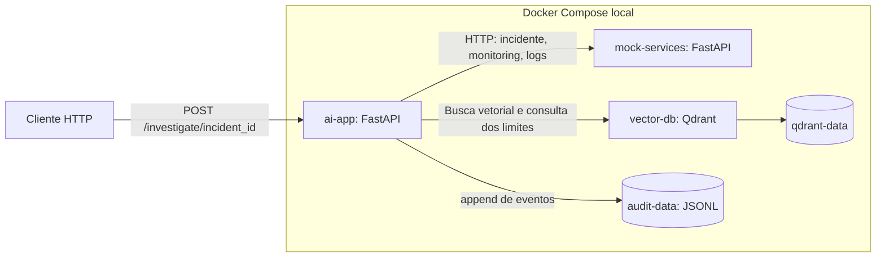
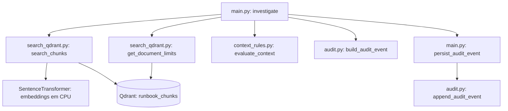
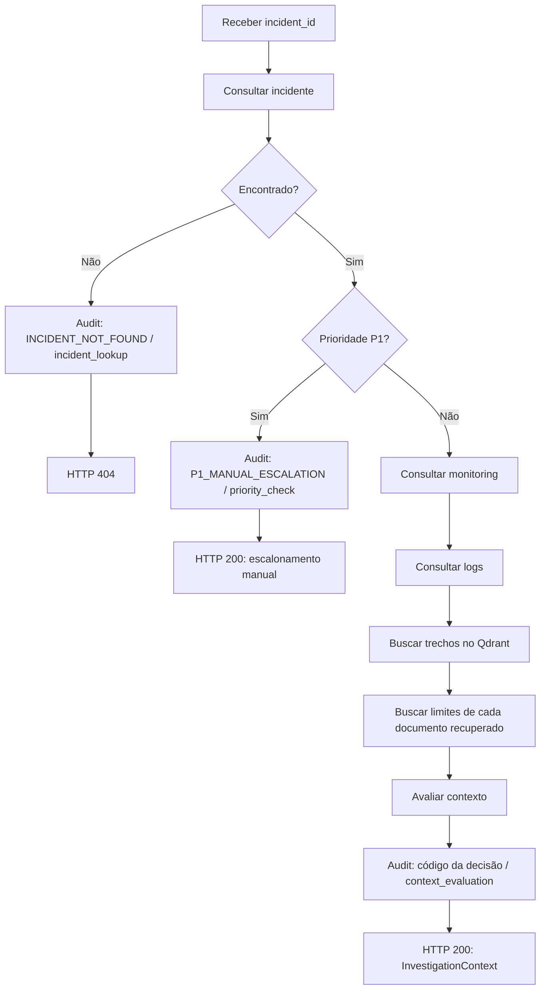

# Arquitetura do AI Incident Operations Assistant

Este documento descreve a estrutura implementada da POC local. As fontes de
referência são [compose.yaml](../compose.yaml), os módulos de
[ai-app](../ai-app/) e [mock-services](../mock-services/).

## Escopo

A aplicação coleta contexto de incidentes fictícios, recupera trechos de runbooks
por similaridade vetorial e aplica regras determinísticas de suficiência do
contexto. Não há LLM, execução automática de ações ou integração com AWS e
Kubernetes. Incidentes P1 interrompem a investigação automática e retornam uma
indicação de escalonamento humano; não enviam uma notificação externa.

## Serviços e persistência



| Serviço         | Acesso pelo host | Endereço usado no Compose   | Persistência                  |
|-----------------|------------------|-----------------------------|------------------------------------|
| `ai-app`        | `127.0.0.1:8000` | Porta `8000`                | `audit-data` em `/app/audit`       |
| `mock-services` | `127.0.0.1:8001` | `http://mock-services:8000` | Dados fictícios em memória         |
| `vector-db`     | `127.0.0.1:6333` | `http://vector-db:6333`     | `qdrant-data` em `/qdrant/storage` |

`ai-app` usa `MOCK_SERVICES_URL`, `QDRANT_URL` e `AUDIT_PATH`.
Fora do Compose, os padrões no código são `http://localhost:8001`,
`http://localhost:6333` e `/app/audit/events.jsonl`, respectivamente.
Os arquivos de aplicação são copiados para a imagem pelo Dockerfile; o projeto
não é montado em `/workspace` na execução normal. Essa montagem é usada para
executar o teste isolado apresentado adiante.

## Estrutura do repositório

```text
.
├── README.md
├── compose.yaml
├── ai-app/
│   ├── Dockerfile
│   ├── requirements.txt
│   ├── main.py                     # API e orquestração
│   ├── search_qdrant.py            # Recuperação no Qdrant
│   ├── context_rules.py            # Decisões determinísticas
│   ├── audit.py                    # Construção e persistência de eventos
│   ├── read_runbook.py             # Runbook → chunks
│   ├── embed_chunks.py             # Chunks → embeddings
│   ├── load_chunks.py              # Carga dos vetores no Qdrant
│   ├── load_one_chunk.py           # Experimento de carga de um trecho
│   ├── search_chunks.py            # Experimento de busca textual
│   ├── retrieve_chunks.py          # Busca em vetores salvos em arquivo
│   └── test_*.py                   # Verificações isoladas e scripts de integração
├── mock-services/
│   ├── Dockerfile
│   ├── requirements.txt
│   └── main.py                     # APIs com dados fictícios
├── data/
│   ├── chunks.json
│   └── chunk_embeddings.json
└── docs/
    ├── architecture.md
    └── runbooks/
        └── checkout-payment-timeout.md
```

## Módulos da investigação



| Módulo                  | Responsabilidade |
|-------------------------|---
| `main.py`               | Expõe `/health` e `/investigate/{incident_id}`; consulta o Mock Services, trata P1, recupera documentação, aplica regras e registra audit. Também define os modelos Pydantic das respostas. |
| `search_qdrant.py`      | Gera o vetor da consulta e busca os trechos com `query_points`; recupera a seção `Limites` de cada documento com `scroll` e filtros. |
| `context_rules.py`      | Retorna `NO_DOCUMENTATION`, `MISSING_DOCUMENT_LIMITS` ou `CONTEXT_READY`, conforme os documentos e seus limites. Não acessa rede ou disco. |
| `audit.py`              | Constrói eventos com UUID, timestamp UTC, incidente, código, IDs de chunks e etapa; acrescenta cada evento como uma linha JSON ao arquivo. |
| `mock-services/main.py` | Expõe `/health`, `/incidents/{incident_id}`, `/monitoring/{application}` e `/logs/{application}`. |

O modelo `sentence-transformers/paraphrase-multilingual-MiniLM-L12-v2` e o cliente
Qdrant são instanciados ao importar `search_qdrant.py`. Portanto, importar
`main.py` normalmente também carrega o modelo e pode exigir download dos pesos.
As consultas documentais e a gravação do audit usam `run_in_threadpool`.

## Fluxo de uma investigação



O diagrama apresenta as saídas principais; as falhas de comunicação são tratadas
conforme a tabela abaixo. A resposta de contexto inclui incidente, monitoring,
logs, documentação, limites e resultado da avaliação. `CONTEXT_READY` indica
suficiência segundo as regras da POC, sem afirmar causa raiz ou recomendar ações.

| Evento                                  | `stage`           | HTTP  |
|-----------------------------------------|-------------------|-------|
| `INCIDENT_NOT_FOUND`                    | `incident_lookup` | `404` |
| `P1_MANUAL_ESCALATION`                  | `priority_check`  | `200` |
| `MOCK_SERVICES_CONNECTION_FAILED`       | Etapa ativa: `incident_lookup`, `monitoring_lookup` ou `logs_lookup` | `503` |
| `MOCK_SERVICES_TIMEOUT`                 | Etapa ativa: `incident_lookup`, `monitoring_lookup` ou `logs_lookup` | `504` |
| `DOCUMENT_BASE_COMMUNICATION_FAILED`    | Etapa ativa: `documentation_search` ou `document_limits_lookup` | `503` |
| Código retornado por `evaluate_context` | `context_evaluation` | `200` |

Falha ao persistir audit retorna `503`. Monitoring ou logs inexistentes retornam
`404`, sem evento de audit específico nesses ramos. O tratamento documental
captura `ResponseHandlingException`; não cobre automaticamente toda exceção
possível do Qdrant. O builder mantém `stage="unspecified"` como padrão quando o
chamador não informa uma etapa.

## Preparação da base documental


Essa preparação é executada separadamente do endpoint de investigação.
`read_runbook.py` separa seções e subseções do runbook RB-001; `embed_chunks.py`
gera e salva vetores; `load_chunks.py` valida as quantidades de chunks e vetores
e faz upsert com IDs UUID derivados de `chunk_id`. A criação da coleção existe
no script `test_qdrant.py`, com dimensão `384` e distância cosseno.

`search_chunks.py`, `retrieve_chunks.py` e `load_one_chunk.py` preservam
experimentos anteriores e não participam do fluxo HTTP atual. Executá-los pode
ler arquivos, carregar modelos ou escrever no Qdrant.

## Testes e isolamento

| Arquivo | Escopo e dependências |
|---|---|
| `test_document_limits_failure.py` | Teste `unittest` da falha na busca de limites. Simula HTTP, recuperação e persistência; verifica HTTP `503`, mensagem e evento com incidente, código e etapa. |
| `test_context_rules.py` | Asserções das decisões puras de suficiência do contexto. |
| `test_audit.py` | Constrói e grava evento em `data/audit/events.log`. |
| `test_qdrant.py` | Consulta Qdrant e cria a coleção se ausente. |
| `test_search.py` e `test_limits.py` | Consultam a base documental real e carregam o módulo de embeddings. |
| `test_embedding.py` | Carrega o modelo e compara similaridades. |

Os scripts existentes não devem ser tratados como uma suíte integralmente
isolada: vários executam trabalho ao serem importados. O teste da falha de
limites substitui `search_qdrant` antes de importar a aplicação, evitando o
carregamento do modelo. `persist_audit_event` é simulado, sem escrita no volume.

Com a imagem de `ai-app` já construída, executar somente esse teste no container,
montando o projeto em modo de leitura, a partir da raiz do repositório:

```bash
docker compose run --rm --no-deps --pull never \
  -v "$PWD:/workspace:ro" -w /workspace \
  ai-app python -B /workspace/ai-app/test_document_limits_failure.py
```

O comando usa as dependências da imagem existente e não inicia mock ou Qdrant.
O teste não valida o download do modelo nem a integração com serviços reais.

## Manutenção

Atualize este documento quando mudar serviços, módulos, persistência, etapas de
audit ou o fluxo da investigação. Parte do README registra fases anteriores da
POC; para a estrutura implementada, consulte este documento e os arquivos-fonte
vinculados no início.
